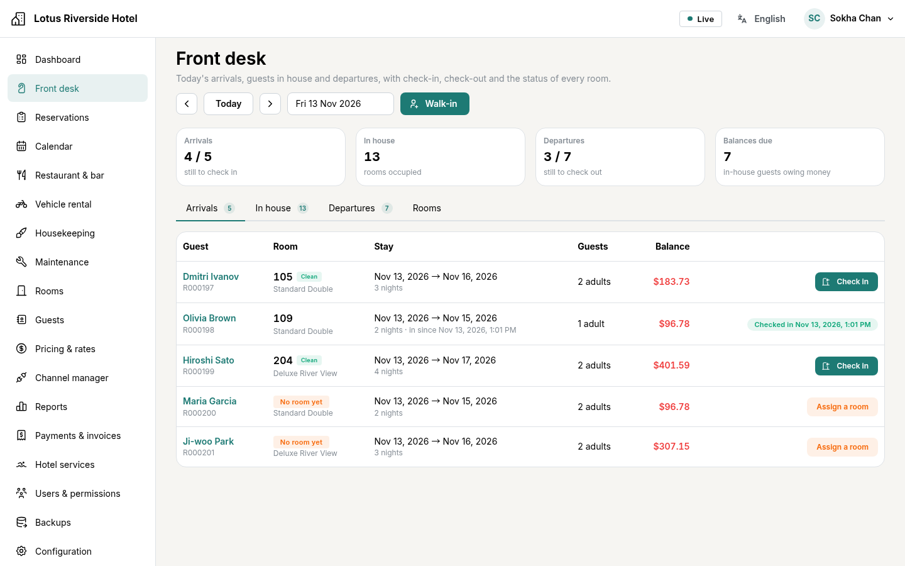
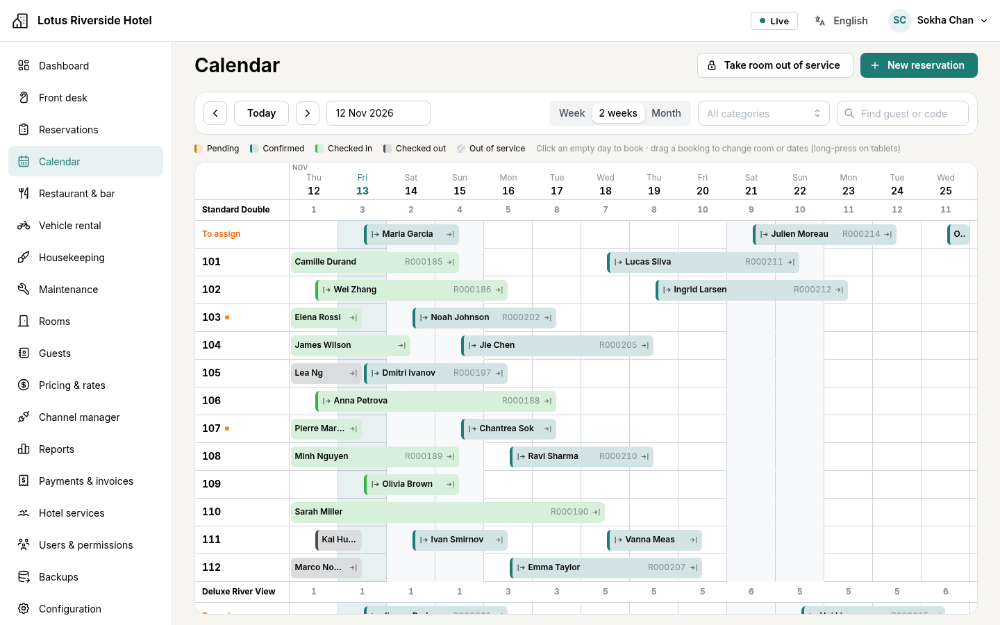
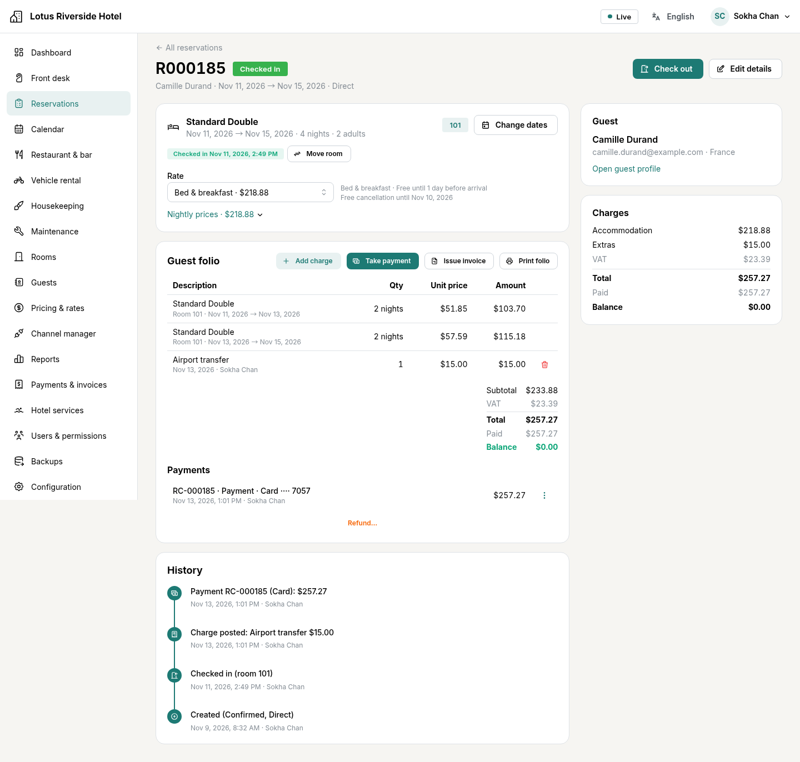
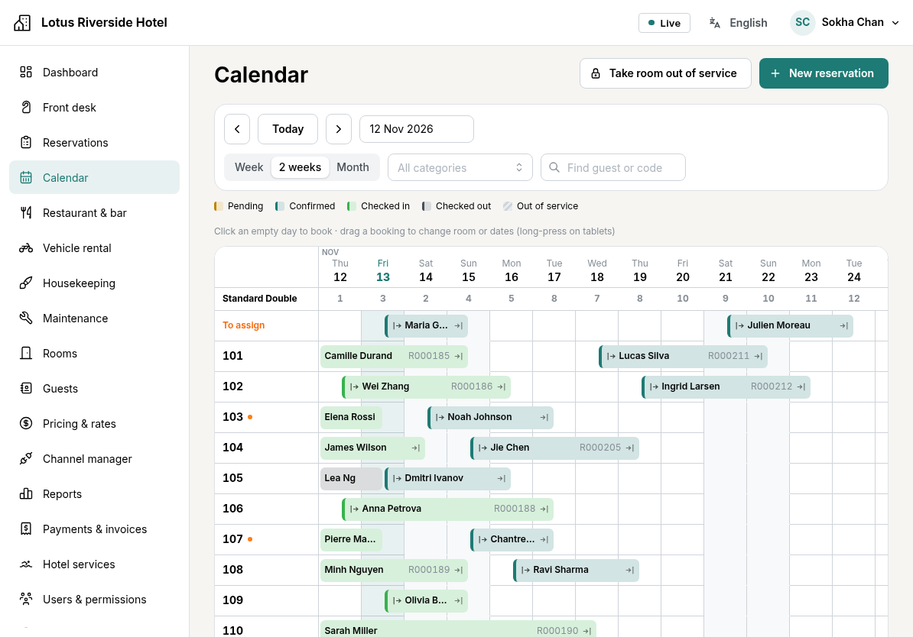
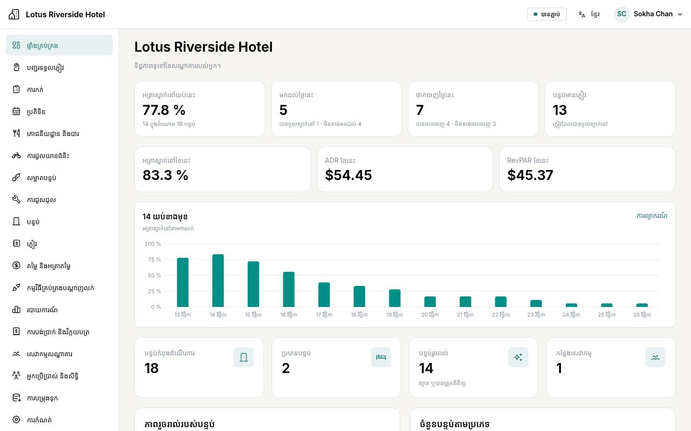

# HMS — Hotel Management System

A centralized, multi-user, multi-language hotel management platform (PMS).
One server and one PostgreSQL database are shared by every device in the
hotel: Linux and Windows desktops, Android tablets and iPads.

**Status: the ten roadmap phases are delivered**: hotel configuration,
reservations with database-enforced inventory integrity, calendar, rate plans
and pricing rules, front desk, folios, payments and invoices, housekeeping,
maintenance, restaurant & bar, vehicle rental, the SiteMinder channel manager,
reports, the desktop application, and the final security and quality phase
(row-level security, backups screen, load test). What is still missing or only
partly verified (for example 2FA recovery codes, guest merge, SiteMinder
certification with a live hotel, real tablets) is listed in
[docs/CHECKLIST.md](docs/CHECKLIST.md), the exact, tested state of every
feature.



| | |
|---|---|
|  |  |
|  |  |

More in the [tour of the screens](docs/guides/screens.md).

| | |
|---|---|
| Backend | Python 3.12, FastAPI, SQLAlchemy 2 (async), Alembic, PostgreSQL 17 |
| Frontend | React 19, TypeScript, Mantine 8, TanStack Query, i18next |
| Real-time | WebSockets fed by PostgreSQL LISTEN/NOTIFY (transactional events) |
| Languages | English, Français, 简体中文, Русский, ខ្មែរ |
| Deployment | Docker Compose: Caddy (TLS) + API + PostgreSQL + verified backups |

## Documentation

- Architecture: [overview](docs/architecture/01-architecture.md) ·
  [database](docs/architecture/02-database.md) ·
  [channel manager / Booking.com / Agoda](docs/architecture/03-channel-manager.md) ·
  [security](docs/architecture/04-security.md) ·
  [roadmap](docs/architecture/05-roadmap.md)
- [Tour of the screens](docs/guides/screens.md) (screenshots)
- User guide for hotel staff, illustrated: [Français](docs/guides/user-guide.fr.md) · [English](docs/guides/user-guide.en.md) · [ខ្មែរ](docs/guides/user-guide.km.md)
- [Installation & operations guide](docs/guides/installation.md): server, devices, backups, restore
- [Reports: definitions of every figure](docs/guides/reports.md)
- [Security audit](docs/security/audit-2026-11.md) · [phase 10 QA report](docs/qa/phase10-report.md)
- [OTA connectivity research](docs/research/ota-connectivity.md) (sourced)
- [Development checklist](docs/CHECKLIST.md)

## Development quick start

```bash
# 1. Database
docker compose -f docker-compose.dev.yml up -d

# 2. Backend (http://127.0.0.1:8000, API docs at /api/docs)
cd backend
python3.12 -m venv .venv && .venv/bin/pip install -e '.[dev]'
.venv/bin/alembic upgrade head           # as the schema owner (hms)
.venv/bin/python -m app.cli db-roles     # the API's own role, hms_api (row-level security applies)
HMS_ADMIN_PASSWORD='Choose-A-Strong-One-1' .venv/bin/python -m app.cli bootstrap \
  --org "My Group" --hotel "My Hotel" --code MYHOTEL \
  --admin-email admin@hotel.lan --admin-name "Administrator" \
  --timezone Asia/Phnom_Penh --currency USD
HMS_COOKIE_SECURE=false .venv/bin/uvicorn app.main:app --reload

# 3. Frontend (http://localhost:5173, proxies /api and the WebSocket)
cd frontend && npm ci && npm run dev
```

## Tests

```bash
cd backend  && .venv/bin/pytest            # real PostgreSQL, run as the least-privilege role (incl. WebSocket, concurrency, row-level security)
cd frontend && npm test                    # unit tests
cd frontend && npm run i18n:check          # translation completeness in all 5 languages
cd frontend && npm run e2e                 # Playwright: desktop, iPad, Android tablet (needs running stack)
deploy/tests/restore-drill.sh              # backup + restore through the API on a throwaway production stack
deploy/tests/load-test.sh                  # load test on a throwaway production stack (results in deploy/tests/results)
```

## Production

See the [installation guide](docs/guides/installation.md). In short:

```bash
cd deploy && cp .env.example .env   # set POSTGRES_PASSWORD, HMS_DB_APP_PASSWORD, HMS_DATA_KEY, HMS_SITE_ADDRESS
docker compose up -d --build
docker compose exec api hms-entrypoint cli bootstrap --org ... --hotel ... --code ... \
  --admin-email ... --admin-name ...
```
