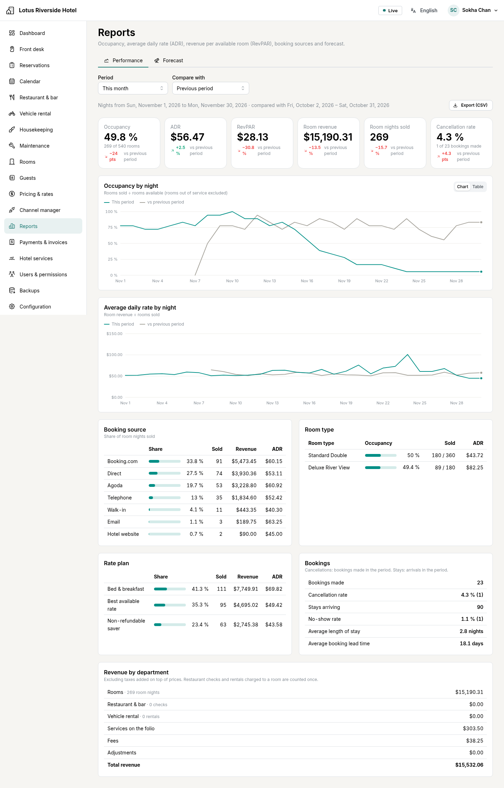
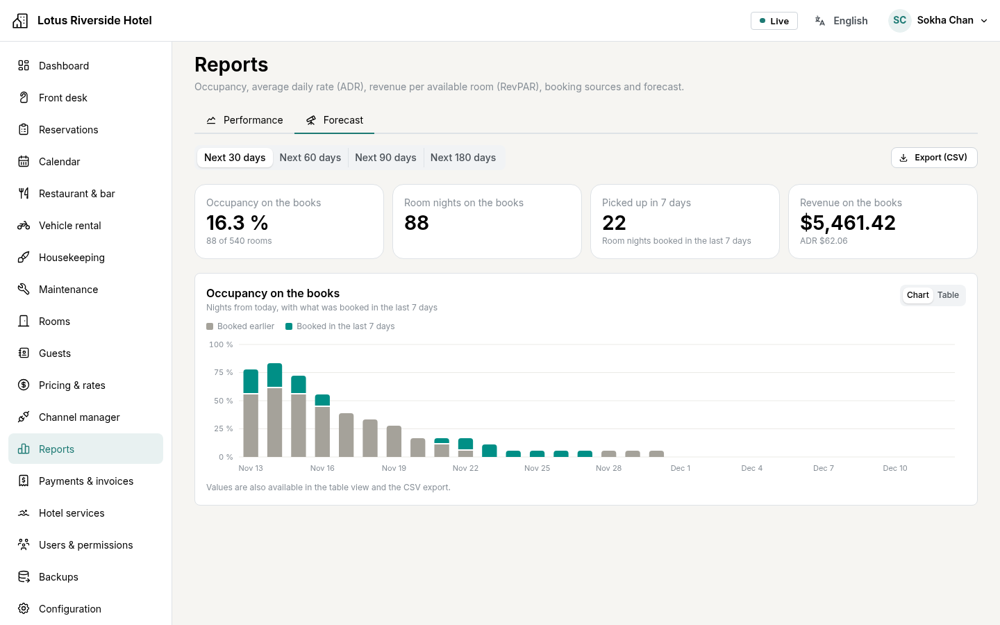

# Reports: what each figure means

The same definitions are used on the dashboard, in *Reports* and in the CSV
exports. A night belongs to the period when the guest sleeps there: a
reservation from 30 November to 2 December counts one night in November and one
in December.

| Figure | Definition |
|--------|-----------|
| **Rooms** | Rooms in service on each night of the period, added up. A room counts from the day it was created, or from an earlier night on which it was sold (history entered after the rooms were set up). |
| **Out of service** | Room-nights blocked for maintenance, out of order or owner use. |
| **Available** | Rooms − out of service. |
| **Sold (room nights)** | Nights of reservations that hold a room: pending, confirmed, in house or checked out. Cancelled and no-show reservations release their nights. Complimentary nights (price 0) count as sold. |
| **Occupancy** | Sold ÷ available. |
| **Room revenue** | The nightly room prices of the nights sold. Taxes included in prices stay included; taxes added on top (for example VAT added at check-out) are excluded. |
| **ADR** (average daily rate) | Room revenue ÷ room nights sold. |
| **RevPAR** (revenue per available room) | Room revenue ÷ rooms available (= ADR × occupancy). |
| **Cancellation rate** | Of the reservations *made* during the period, the share that is now cancelled. |
| **No-show rate** | No-shows ÷ (stays arriving in the period + no-shows). |
| **Average length of stay** | Nights per stay, for stays arriving in the period. |
| **Booking lead time** | Days between the booking and the arrival, for stays arriving in the period. A booking made on the arrival day or entered afterwards (walk-in, history typed in later) counts 0, never a negative number. |
| **On the books / pickup** | In the forecast: room nights already reserved for each coming night, and how many of them were booked in the last 7 days. |
| **Revenue by department** | Rooms; restaurant checks closed in the period; vehicle rentals returned in the period; services, fees and adjustments on folios (by service date). All before taxes added on top. A restaurant check or a rental charged to a room is counted once, under the restaurant or the rentals. |

When there is nothing to divide by (no room available, nothing sold), the
ratio is shown as "—", never as a misleading 0.

**Who sees what.** Occupancy, room nights and booking figures need the
*Reports* permission. Revenue, ADR and RevPAR also need *Financial reports*.
Front-desk staff see today's arrivals, departures and occupancy on the
dashboard.

**Comparisons.** *Previous period* is the same number of nights just before.
*Same period last year* uses the same dates one year earlier (29 February
becomes 28 February).

**CSV exports** open directly in Excel or LibreOffice. In languages that write
decimals with a comma (French, Russian), columns are separated by semicolons,
as these spreadsheets expect. Amounts are plain numbers in the hotel currency,
given in the column title.

**Company accounts.** When a departing guest's bill is transferred to a
company account, the folio is settled but no money is received: the transfer
is left out of the payments received and of the end-of-day cash-up (shown
there on its own line, with the invoices). The company's payment counts as
money received on the day it arrives, under *Company accounts*. With a split
bill only the company's part is transferred; the guest's payments count as
usual.

**Rooms taken out of service.** A room counts on the nights it was part of the
hotel: from the night it was created, until the night it was deactivated, and
again from the night it is reactivated. Deactivating a room therefore changes
the figures from tonight on, never those of past periods. A room cannot be
deactivated while guests are in it tonight or booked into it later: move them
first. For works of a few days or weeks, take the room out of service from a
maintenance request instead: it stays in the hotel and counts as *out of
service*.
