# HMS — User guide

[Français](user-guide.fr.md) · English · [ខ្មែរ](user-guide.km.md)

## About this guide

This guide explains, screen by screen, how to use HMS every day: reservations, front desk, housekeeping, maintenance, restaurant, vehicle rental and the end of day. The last part is for managers who configure the hotel.

- Three versions: Français, English (this document) and ខ្មែរ. Screenshots are in the document's language.
- Screenshots show the demo hotel *Lotus Riverside Hotel*; guests and bookings are fictitious.
- Each staff member sees only the menus of their role: a missing menu entry is normal.
- Button names are written **in bold**, exactly as they appear on screen.

## 1. Getting started

HMS opens in the browser at the hotel server's address (for example `https://hms.lan`), on a computer, a tablet or in the desktop application. Every staff member has their own account.

1. Enter your **Email** and **Password**, then click **Sign in**. If two-factor authentication is on, enter the 6-digit code from your app. Lost your phone? Choose **Lost your phone? Use a recovery code** and type one of your recovery codes (each works once).
2. Change the language with the language button at the top right (English, Français, 简体中文, Русский, ខ្មែរ). Your choice follows you on every device.
3. The menu on the left opens each module. On a tablet, open it with the ☰ button.
4. The **Live** indicator at the top confirms the real-time link: what a colleague saves appears on your screen without reloading.
5. To leave, open the account menu (your initials), then **Sign out**.

If the network drops, a banner says so and the save buttons are disabled: nothing is half-saved. Try again once the indicator shows **Live**.

On a tablet, add HMS to the home screen (iPad: Share → Add to Home Screen; Android: Chrome menu → Install app). The desktop application (Windows, Linux) asks for the server address the first time it starts.

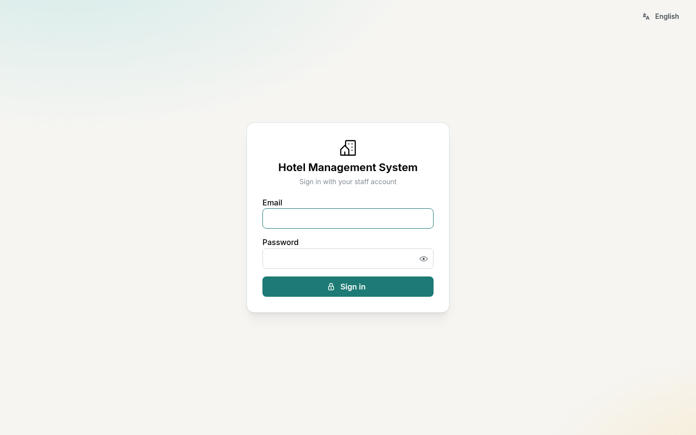

## 2. Dashboard

The **Dashboard** sums up the day as soon as you sign in: tonight's occupancy, arrivals, departures and guests in house.

- The month's figures: occupancy, average daily rate (ADR) and RevPAR. Amounts are shown only to accounts with the *financial reports* permission.
- The next 14 nights on the books, room readiness (clean, to clean, out of service) and the hotel's inventory.
- The arrival and departure lists lead straight to the reservation.

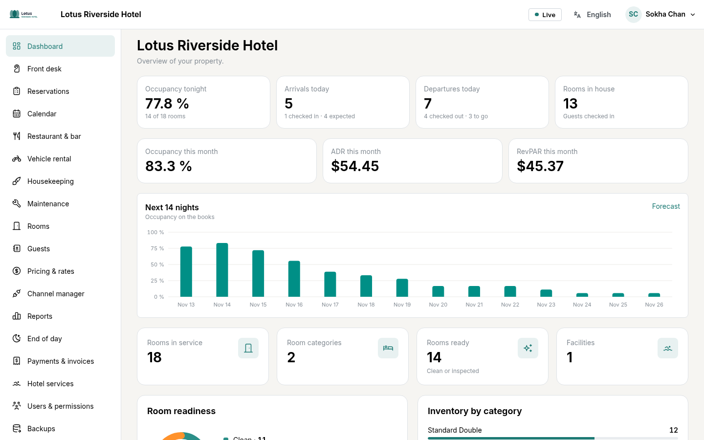

## 3. Calendar and reservations

The **Calendar** shows one line per room and one column per day: this is where bookings are made and moved. Under each category, the number of rooms still free is shown for every night.

**Make a reservation**

1. Click an empty cell (the room, the arrival day) or **New reservation**.
2. Choose the dates, the category, the number of adults and children. The price comes from the rate plan.
3. Search for the guest or enter a new one, then save.

**Move**: drag the booking to another room or other dates (long-press on a tablet), then confirm. HMS refuses any double booking of a room, whichever device made the change. Bookings without a room are on the **To assign** line.

**The reservation page** holds the stay (room, dates, rate, cancellation terms), the folio, payments, invoices and the full history of changes.

- **Cancel reservation**: the fee set by the cancellation policy is shown before you confirm.
- **No-show**: for a guest who was expected and never arrived.

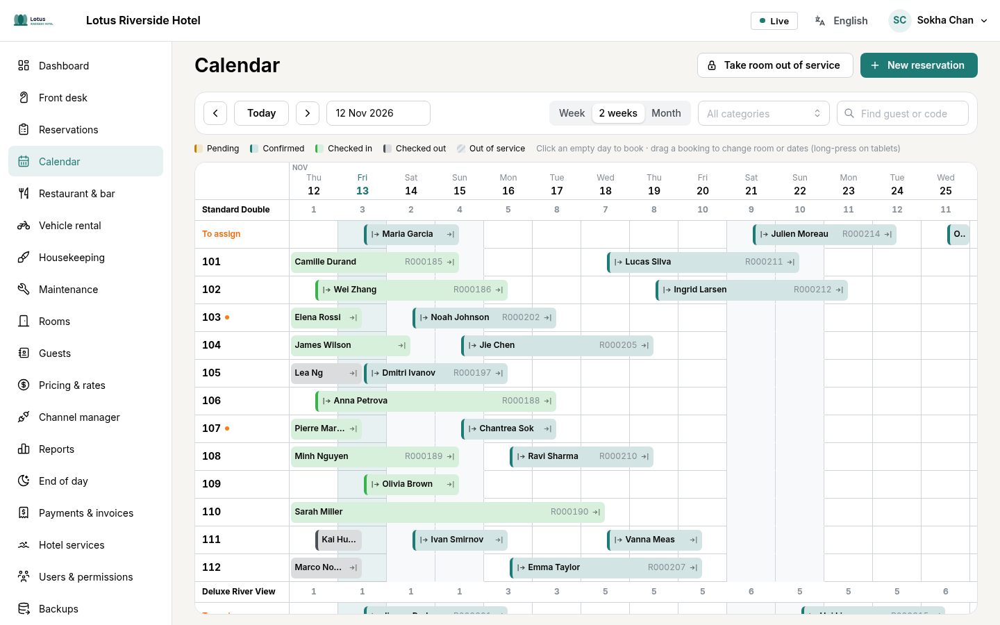

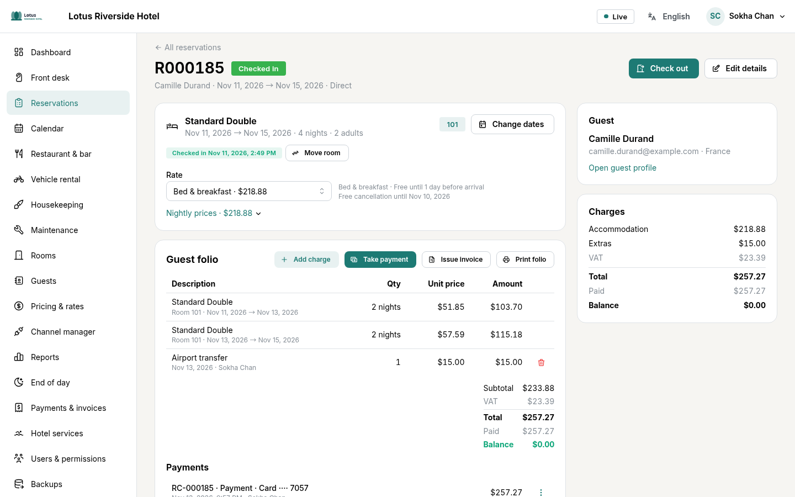

## 4. Front desk: arrival, stay, departure

The **Front desk** screen lists the day's arrivals, guests in house, departures and the status of every room, with each stay's balance.

**Arrival**

1. If the booking has no room yet: **Assign a room**.
2. Click **Check in**. If the room is not clean yet, HMS warns you; you can choose **Check in anyway**.
3. A guest without a booking: **Walk-in** creates a booking for tonight.

**During the stay**, the folio collects the nights, the extras added with **Post charge** (minibar, laundry…), and restaurant bills and rentals charged to the room.

**Payment**: **Take payment**, choose the method (cash, card, transfer…) and the currency; riel is converted at the day's rate. The **Receipt (PDF)** prints from the list of payments.

**Departure**

1. Click **Check out**.
2. If a balance remains, take it or leave it open. An early departure releases the remaining nights.
3. **Issue invoice** produces the PDF invoice, numbered without gaps. An issued invoice cannot be changed: it is voided and issued again.

**Direct billing to a company** (travel agency, business): on the reservation, **Edit details**, then choose the company under **Direct billing**. At departure, **Transfer to …** (on the folio or in the check-out window) issues the invoice to the company and settles the guest's folio; the company pays later. Extras the guest pays personally are taken before the transfer.

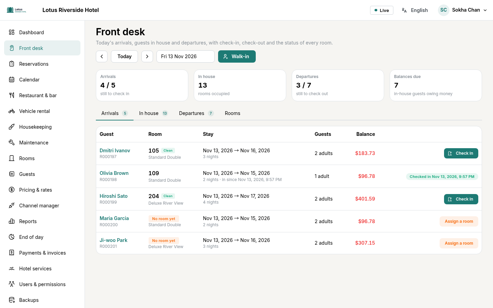

## 5. Housekeeping and maintenance

**Housekeeping**: each morning, **Prepare today's list** creates the departure cleans and stayover services from the reservations.

1. The supervisor assigns the tasks to the room attendants.
2. On their tablet, the attendant taps **Start**, then **Done**.
3. The supervisor checks the room and taps **Approve**: the room becomes **Inspected** and the front desk sees it at once.

**Maintenance**: any staff member can report a problem, with photos.

1. **Report a problem**: choose the room (or **Elsewhere** and a location), the type of problem, the priority and a short description.
2. **Add photos**: take the photo with the tablet or pick it from the gallery (10 at most). The GPS position is removed automatically.
3. **Send report**. Technicians see it straight away.

The technician starts the work, puts it on hold or completes it with a note of what was done. **Take the room out of service** blocks the room for the chosen dates: no booking can land on it. When the work is finished, the room goes back into service and to housekeeping.

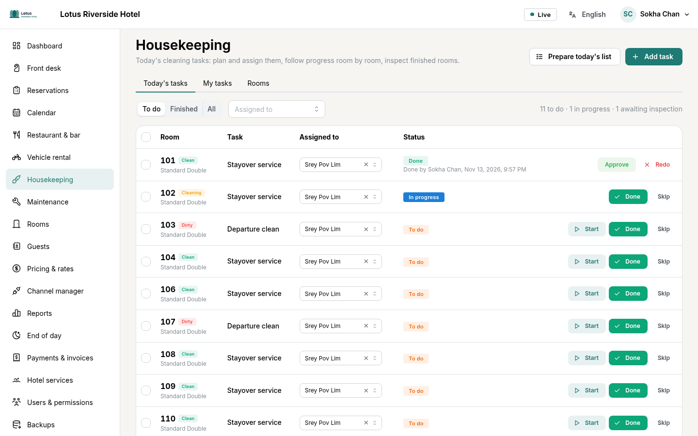

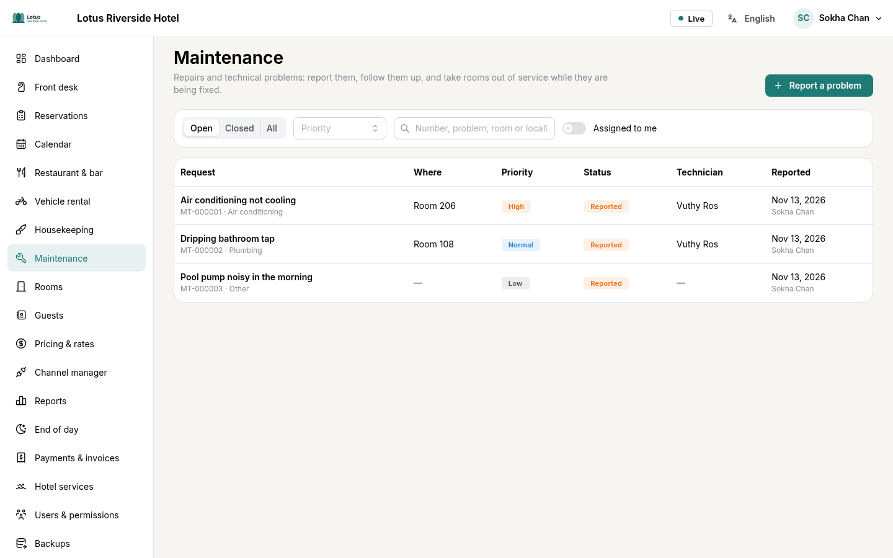

## 6. Restaurant & bar

The **Tables** tab shows the floor plan with the open checks; takeaway orders and room service have their own list.

1. Tap a table and add items from the menu (quantity, a note for the kitchen).
2. **Send to kitchen**: the **Kitchen** screen (and the bar's) shows each item with the time since it was sent. The kitchen marks it ready.
3. At the end of the meal, take payment (cash with change, card…) or choose **Charge to room** for a hotel guest: the amount appears on their folio.
4. The bill prints as a PDF.

An item already sent to the kitchen is not deleted: it is voided, with a reason.

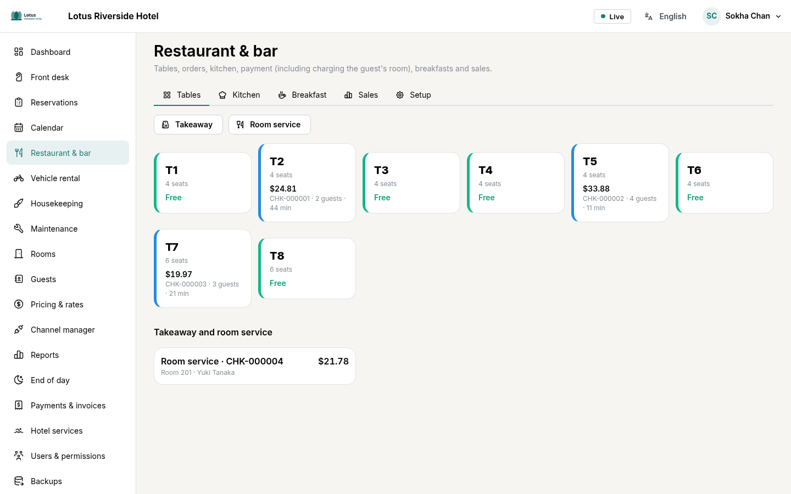

## 7. Vehicle rental

Scooters, cars with or without a driver, tuk-tuks and bicycles are rented by the hour or by the day. The schedule shows each vehicle and its rentals.

1. **New rental**: choose the customer (a hotel guest or someone else), a free vehicle and the period. The price and the deposit are shown before booking.
2. **Hand over**: driving licence number (only its last 4 digits stay visible), odometer, fuel, deposit taken.
3. **Take back**: odometer and fuel on return, any extra charges.
4. Take payment, or charge it to the guest's room. The **Contract** prints as a PDF for the customer and the hotel to sign.

A vehicle that is still out cannot be handed over to another customer; late returns are marked **Overdue**.

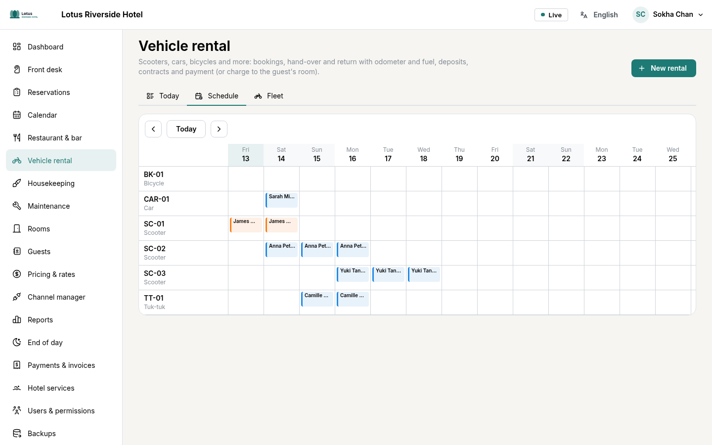

## 8. Pricing and channel manager

The **Rate calendar** shows the price of each category, night by night, for each rate plan. Click a day to change the price or close the sale (minimum stay, closed to arrival…).

- Rate plans can derive from a base plan (for example −10 % non-refundable, breakfast included).
- Seasons and rules (discounts, supplements) apply automatically; one engine computes every price, in the calendar and in the booking.

The **Channel manager** links HMS to SiteMinder, which distributes to Booking.com, Agoda and other sites. Each category and rate plan is matched to its SiteMinder code there; received bookings and the log of every exchange can be checked. Going live is done with the technical manager.

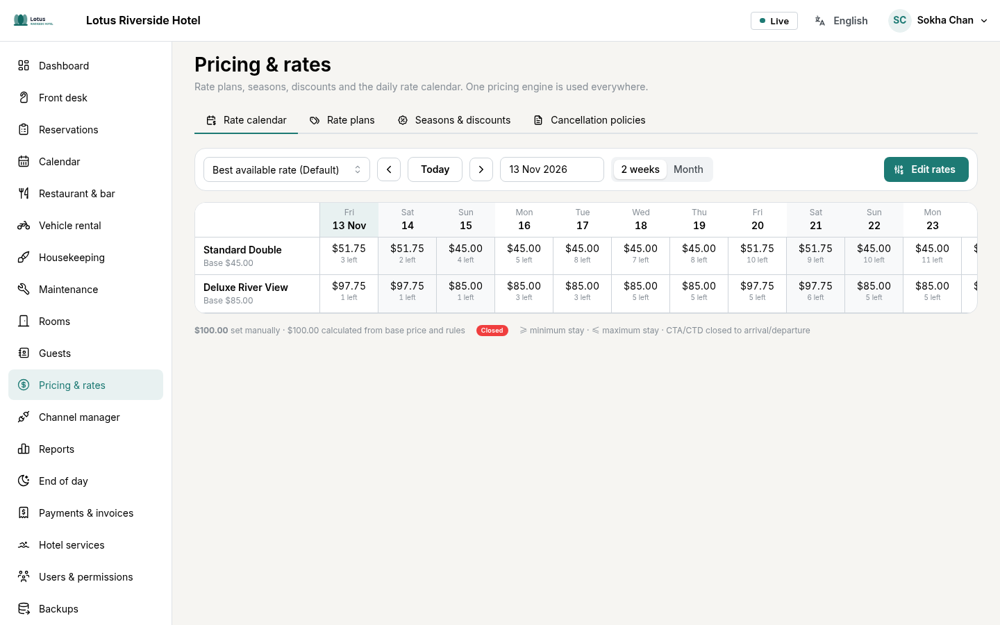

## 9. Reports and end of day

**Reports** give occupancy, ADR, RevPAR and revenue by period, compared with the previous period, and the forecast; every table exports to CSV.

The **End of day** is run after midnight, for the day that just ended (usually by the night receptionist).

1. Deal with what is still open: expected guests who did not arrive (**No-show** button), guests due out still in house, open restaurant checks, vehicles not returned, tomorrow's arrivals without a room, balances due.
2. Check the day's figures and the cash-up by payment method (front desk, restaurant, rentals).
3. **Close the day**. The **Day report (PDF)** is saved.

A closed day is frozen: no charge or payment can be added to it or voided. Corrections are made on the current day.

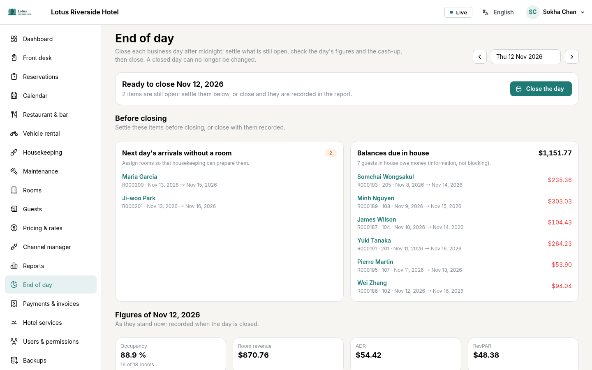

**Company accounts** (accounting): each company's balance, its open invoices and how late they are (not yet due, 1–30 days late…). When the company pays, **Record a payment**: the amount goes to the oldest invoices first. The **Statement (PDF)** is sent to the company. A transfer is not money received: it stays out of the day's cash-up, company payments count in it.

## 10. Configuration (managers)

**Configuration** describes the hotel; it is for administrators and managers.

- **Hotel profile**: name, address, contacts, time zone, currency, languages, check-in and check-out times, policies and invoice details. The **Logo** (button **Upload a logo**) appears in the header and on every PDF document; it is saved as soon as you choose it.
- **Room categories**: occupancy, beds, base price, amenities and up to 20 photos (**Add photos**, order can be changed). Rooms are created one by one or as a range (101 to 120).
- **Hotel services**: facilities (pool, spa…) with opening hours and photos, and the extras you sell.
- **Users & permissions**: **Add user** and give them a role (front desk, housekeeping, maintenance, restaurant, accountant…). Connected devices, sign-in history and the audit trail are here too. A role can require two-factor authentication (switch on its card): its holders set it up at their next sign-in.
- **Backups**: the state of the automatic backups, **Back up now** and restore (password and the hotel's code required). Photos and the logo are included in the backups.

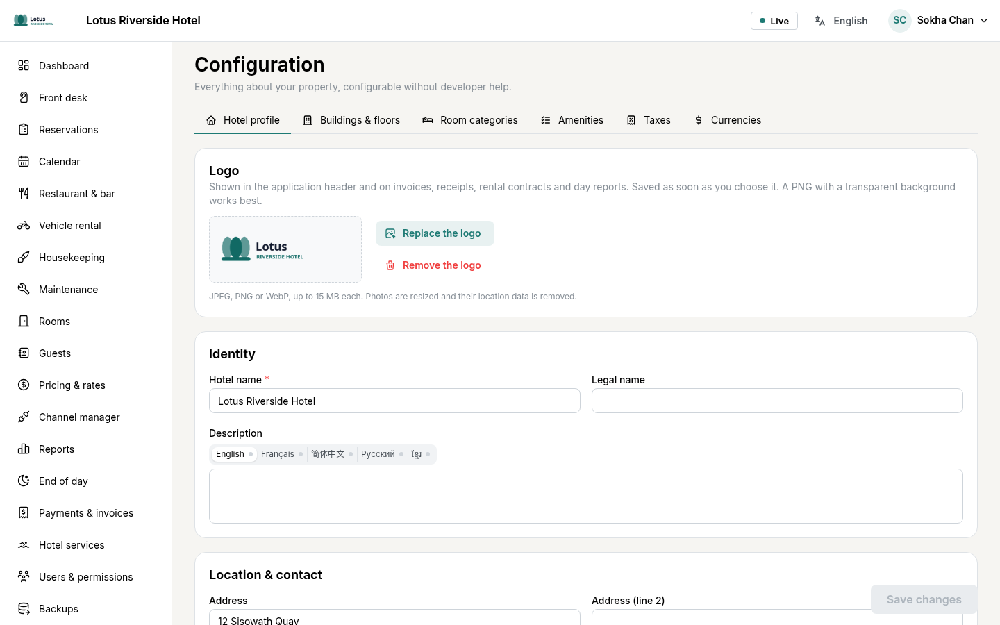
