# HMS — Mode d'emploi

Français · [English](user-guide.en.md) · [ខ្មែរ](user-guide.km.md)

## À propos de ce guide

Ce guide explique, écran par écran, comment utiliser HMS au quotidien : réservations, réception, ménage, maintenance, restaurant, location de véhicules et clôture de journée. La dernière partie s'adresse aux responsables qui configurent l'hôtel.

- Trois versions : français (ce document), English et ខ្មែរ. Les captures d'écran sont dans la langue du document.
- Les captures montrent l'hôtel de démonstration *Lotus Riverside Hotel* ; les clients et réservations sont fictifs.
- Chaque employé ne voit que les menus de son rôle : une entrée absente de votre menu est normale.
- Les noms de boutons sont écrits **en gras**, tels qu'ils apparaissent à l'écran.

## 1. Prise en main

HMS s'ouvre dans le navigateur à l'adresse du serveur de l'hôtel (par exemple `https://hms.lan`), sur ordinateur, tablette ou dans l'application de bureau. Chaque employé a son propre compte.

1. Saisissez votre **E-mail** et votre **Mot de passe**, puis cliquez **Se connecter**. Si la double authentification est activée, saisissez le code à 6 chiffres de votre application. Téléphone perdu : choisissez **Téléphone perdu ? Utiliser un code de secours** et saisissez l'un de vos codes de secours (chacun ne sert qu'une fois).
2. Changez la langue avec le bouton de langue en haut à droite (English, Français, 简体中文, Русский, ខ្មែរ). Le choix vous suit sur tous vos appareils.
3. Le menu de gauche donne accès aux modules. Sur tablette, ouvrez-le avec le bouton ☰.
4. L'indicateur **Connecté** en haut confirme la liaison en temps réel : ce qu'un collègue enregistre apparaît chez vous sans recharger la page.
5. Pour quitter, ouvrez le menu du compte (vos initiales) puis **Se déconnecter**.

Si le réseau tombe, un bandeau l'indique et les boutons d'enregistrement se désactivent : rien n'est enregistré à moitié. Réessayez quand l'indicateur repasse à **Connecté**.

Sur tablette, ajoutez HMS à l'écran d'accueil (iPad : Partager → Sur l'écran d'accueil ; Android : menu de Chrome → Installer l'application). L'application de bureau (Windows, Linux) demande l'adresse du serveur au premier démarrage.

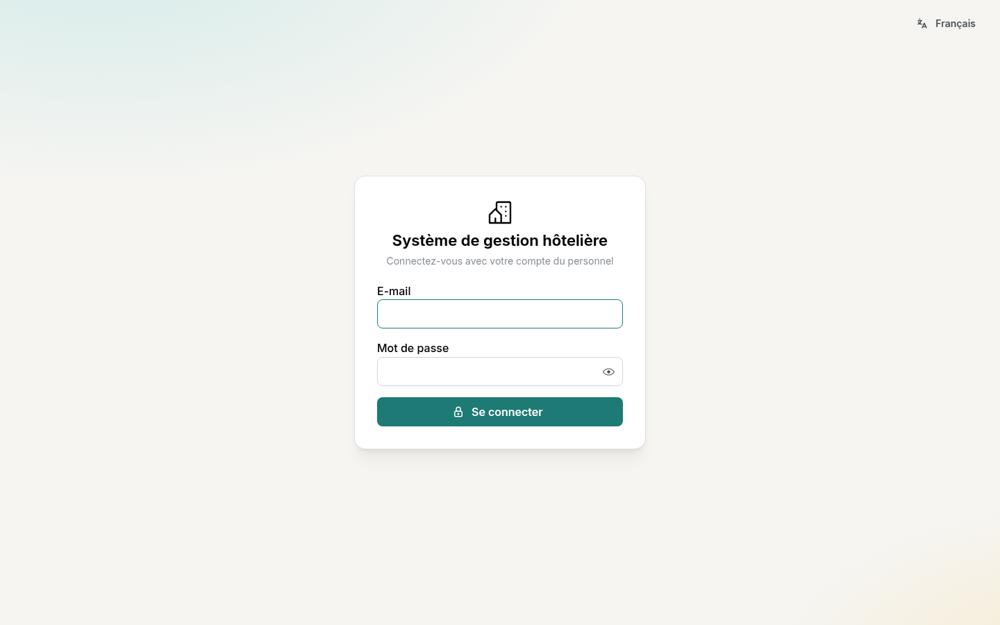

## 2. Tableau de bord

Le **Tableau de bord** résume la journée dès la connexion : occupation de ce soir, arrivées, départs et clients présents.

- Chiffres du mois : taux d'occupation, prix moyen par chambre (ADR) et RevPAR. Les montants ne s'affichent qu'aux comptes qui ont le droit « rapports financiers ».
- Les 14 prochaines nuits réservées, l'état des chambres (propres, à nettoyer, hors service) et l'inventaire de l'hôtel.
- Les listes d'arrivées et de départs mènent directement à la réservation concernée.

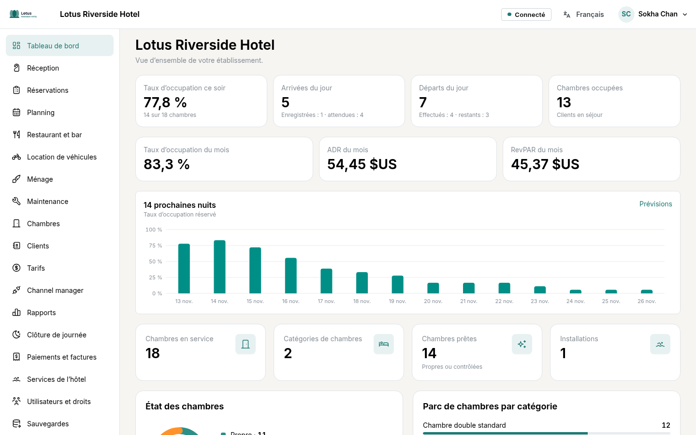

## 3. Planning et réservations

Le **Planning** montre une ligne par chambre et une colonne par jour : c'est là qu'on crée et déplace les réservations. Sous chaque catégorie, le nombre de chambres encore libres s'affiche pour chaque nuit.

**Créer une réservation**

1. Cliquez sur une case vide (la chambre, le jour d'arrivée) ou sur **Nouvelle réservation**.
2. Choisissez les dates, la catégorie, le nombre d'adultes et d'enfants. Le prix est calculé selon le plan tarifaire.
3. Recherchez le client ou saisissez un nouveau client, puis enregistrez.

**Déplacer** : faites glisser la réservation vers une autre chambre ou d'autres dates (appui long sur tablette), puis confirmez. HMS refuse toute double occupation d'une chambre, quel que soit l'appareil utilisé. Les réservations sans chambre sont sur la ligne **À attribuer**.

**La fiche réservation** regroupe le séjour (chambre, dates, tarif, conditions d'annulation), le compte client, les paiements, les factures et l'historique de toutes les modifications.

- **Annuler la réservation** : les frais prévus par la politique d'annulation s'affichent avant de confirmer.
- **Non-présentation** : pour un client attendu qui n'est jamais arrivé.

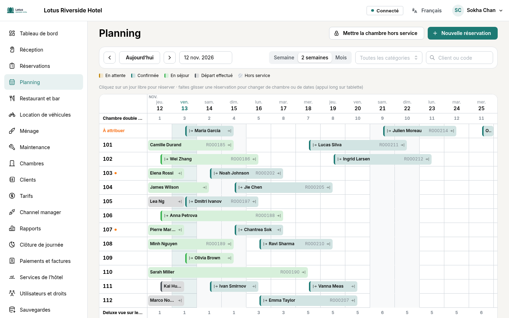

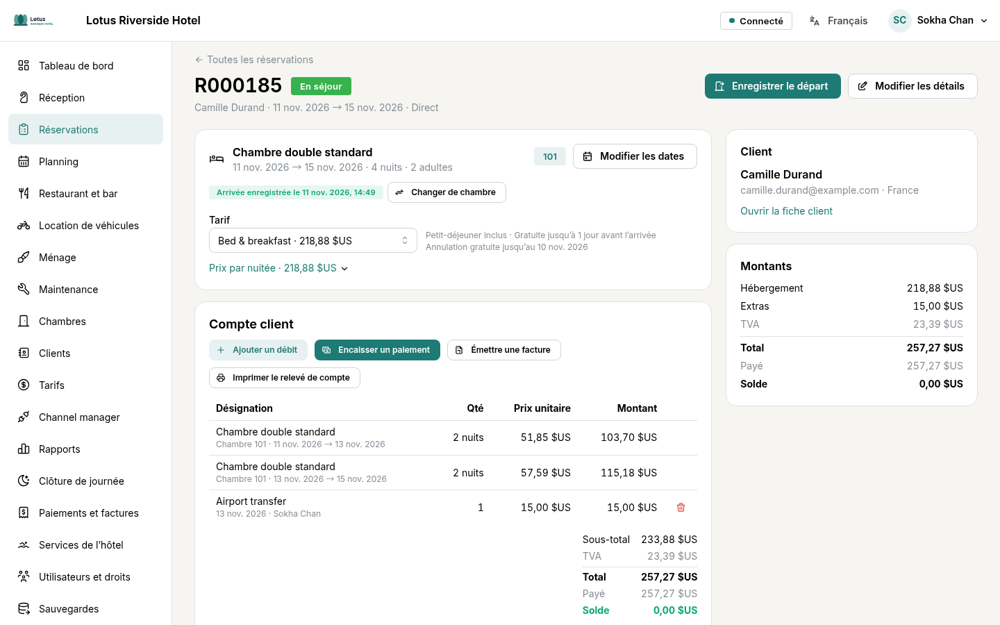

## 4. Réception : arrivée, séjour, départ

L'écran **Réception** liste pour la journée les arrivées, les clients présents, les départs et l'état de chaque chambre, avec le solde de chaque séjour.

**Arrivée**

1. Si la réservation n'a pas encore de chambre : **Attribuer une chambre**.
2. Cliquez **Enregistrer l'arrivée**. Si la chambre n'est pas encore propre, HMS vous prévient ; vous pouvez choisir **Enregistrer l'arrivée quand même**.
3. Client sans réservation : **Client de passage** crée une réservation pour ce soir.

**Pendant le séjour**, le compte client reçoit les nuits, les prestations ajoutées avec **Imputer le débit** (minibar, blanchisserie…), ainsi que les notes du restaurant et les locations imputées sur la chambre.

**Paiement** : **Encaisser un paiement**, choisissez le moyen (espèces, carte, virement…) et la devise ; les riels sont convertis au taux du jour. Le **Reçu (PDF)** s'imprime depuis la liste des paiements.

**Départ**

1. Cliquez **Enregistrer le départ**.
2. S'il reste un solde, encaissez-le ou laissez-le ouvert. Un départ anticipé libère les nuits restantes.
3. **Émettre une facture** produit la facture PDF, numérotée sans trou. Une facture émise ne se modifie pas : elle s'annule puis se réémet.

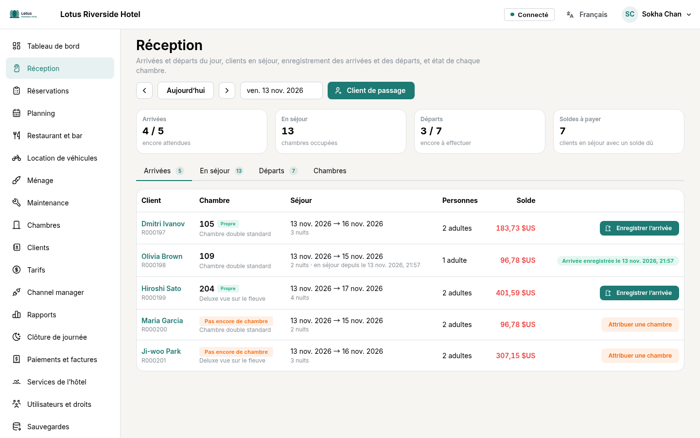

## 5. Ménage et maintenance

**Ménage** : chaque matin, **Préparer la liste du jour** crée les nettoyages de départ et les recouches à partir des réservations.

1. Le responsable attribue les tâches aux femmes de chambre.
2. Sur sa tablette, la femme de chambre appuie sur **Commencer**, puis **Terminer**.
3. Le responsable contrôle et appuie sur **Valider** : la chambre passe à **Contrôlée** et la réception le voit aussitôt.

**Maintenance** : tout employé peut signaler une panne, avec des photos.

1. **Signaler un problème** : choisissez la chambre (ou **Ailleurs** et un lieu), le type de problème, la priorité et une courte description.
2. **Ajouter des photos** : prenez la photo avec la tablette ou choisissez-la dans la galerie (10 au plus). La position GPS est retirée automatiquement.
3. **Envoyer le signalement**. Les techniciens le voient tout de suite.

Le technicien commence le travail, le met en attente ou le termine en décrivant la réparation. **Mettre la chambre hors service** bloque la chambre aux dates choisies : aucune réservation ne peut y tomber. À la fin des travaux, la chambre revient en service et part au ménage.

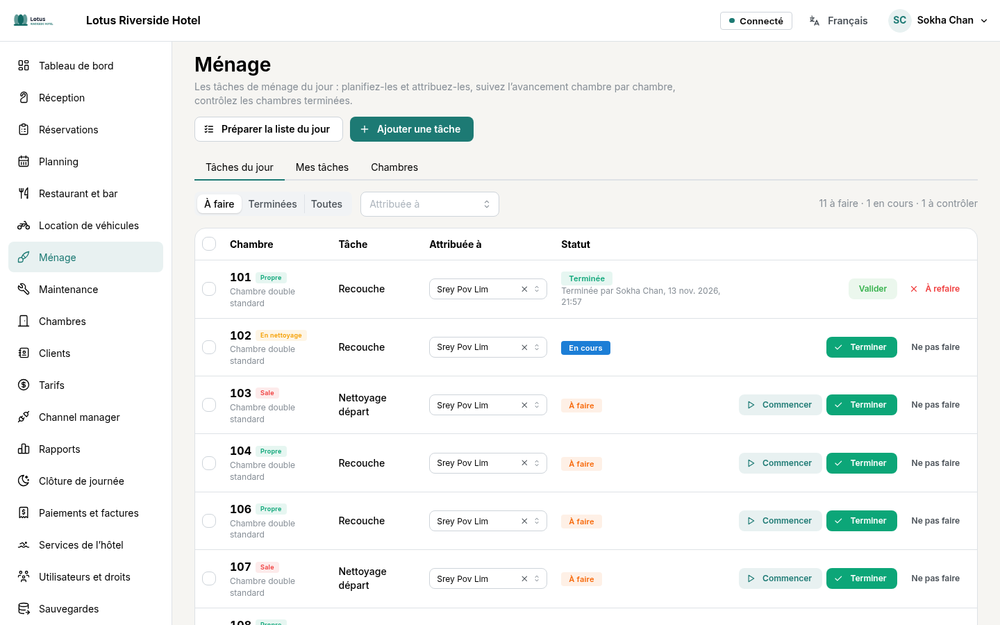

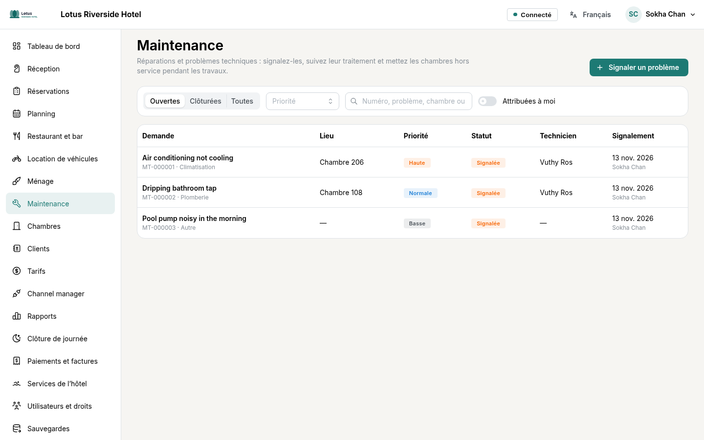

## 6. Restaurant et bar

L'onglet **Tables** montre le plan de salle avec les additions ouvertes ; les commandes à emporter et le service en chambre ont leur propre liste.

1. Touchez une table, ajoutez les articles de la carte (quantité, remarque pour la cuisine).
2. **Envoyer en cuisine** : l'écran **Cuisine** (et celui du bar) affiche chaque article avec le temps écoulé. La cuisine indique quand c'est prêt.
3. À la fin du repas, encaissez l'addition (espèces avec rendu de monnaie, carte…) ou choisissez **Imputer sur la chambre** pour un client de l'hôtel : le montant apparaît sur son compte client.
4. L'addition s'imprime en PDF.

Un article déjà envoyé en cuisine ne se supprime pas : il s'annule, avec un motif.

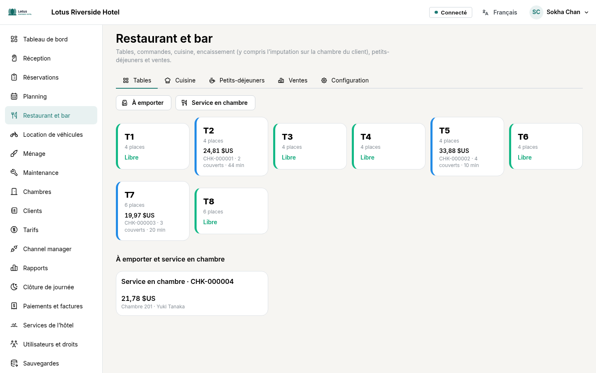

## 7. Location de véhicules

Scooters, voitures avec ou sans chauffeur, tuk-tuks et vélos se louent à l'heure ou à la journée. Le planning montre chaque véhicule et ses locations.

1. **Nouvelle location** : choisissez le client (client de l'hôtel ou autre), le véhicule libre et la période. Le prix et la caution s'affichent avant de réserver.
2. **Remettre le véhicule** : numéro de permis (seuls les 4 derniers chiffres restent visibles), compteur, carburant, caution encaissée.
3. **Reprendre le véhicule** : compteur et carburant au retour, éventuels frais.
4. Encaissez, ou imputez sur la chambre du client. Le **Contrat** s'imprime en PDF à signer par le client et l'hôtel.

Un véhicule encore sorti ne peut pas être remis à un autre client ; les retards sont marqués « En retard ».

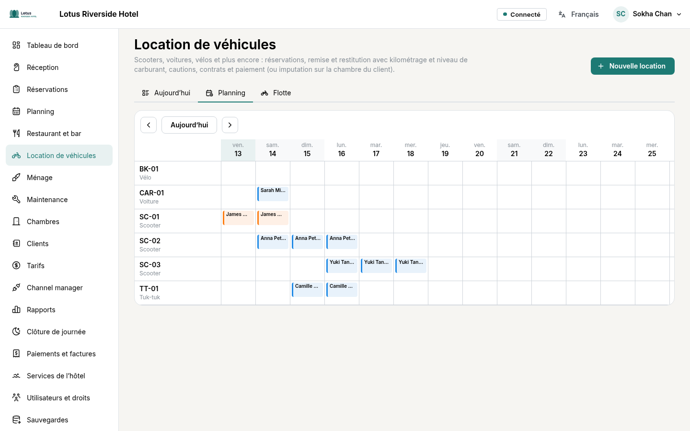

## 8. Tarifs et channel manager

Le **Calendrier des tarifs** montre le prix de chaque catégorie, nuit par nuit, pour chaque plan tarifaire. Cliquez sur un jour pour changer le prix ou fermer la vente (séjour minimum, arrivée interdite…).

- Les plans tarifaires peuvent dériver d'un plan de base (par exemple −10 % sans annulation, petit-déjeuner inclus).
- Les saisons et les règles (remises, suppléments) s'appliquent automatiquement ; un seul moteur calcule tous les prix, au planning comme à la réservation.

Le **Channel manager** relie HMS à SiteMinder, qui diffuse vers Booking.com, Agoda et les autres sites. On y associe chaque catégorie et plan tarifaire à son code chez SiteMinder ; les réservations reçues et le journal des échanges y sont consultables. La mise en service se fait avec le responsable technique.

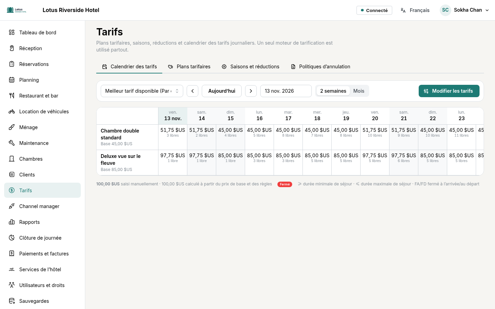

## 9. Rapports et clôture de journée

Les **Rapports** donnent l'occupation, l'ADR, le RevPAR et le chiffre d'affaires par période, comparés à la période précédente, ainsi que les prévisions ; chaque tableau s'exporte en CSV.

La **Clôture de journée** se fait après minuit, pour la journée qui vient de se terminer (en général par le réceptionniste de nuit).

1. Traitez ce qui reste ouvert : clients attendus non arrivés (bouton **Non-présentation**), départs non faits, additions du restaurant ouvertes, véhicules non rendus, arrivées du lendemain sans chambre, soldes dus.
2. Vérifiez les chiffres du jour et la caisse par moyen de paiement (réception, restaurant, locations).
3. **Clôturer la journée**. Le **Rapport du jour (PDF)** est enregistré.

Une journée clôturée est figée : plus aucune prestation ni paiement ne peut y être ajouté ou annulé. Les corrections se font sur la journée en cours.

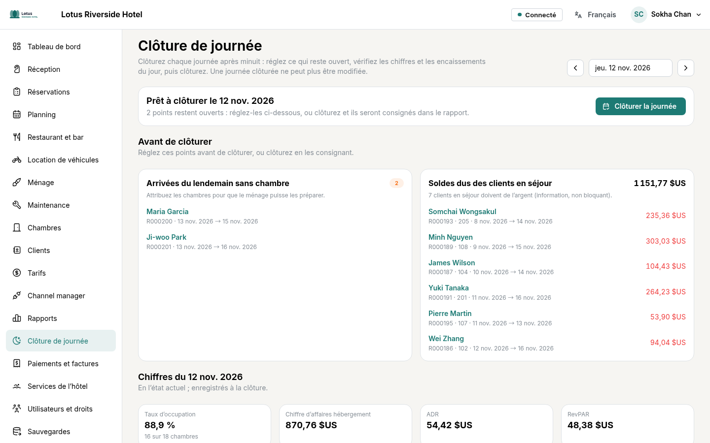

## 10. Configuration (responsables)

La **Configuration** décrit l'hôtel ; elle est réservée aux administrateurs et directeurs.

- **Profil de l'hôtel** : nom, adresse, contacts, fuseau horaire, devise, langues, heures d'arrivée et de départ, politiques et mentions des factures. Le **Logo** (bouton **Ajouter un logo**) apparaît dans l'en-tête et sur tous les documents PDF ; il est enregistré dès qu'on le choisit.
- **Catégories de chambres** : occupation, lits, prix de base, équipements et jusqu'à 20 photos (**Ajouter des photos**, ordre modifiable). Les chambres se créent une par une ou par série (101 à 120).
- **Services de l'hôtel** : installations (piscine, spa…) avec horaires et photos, et prestations vendues.
- **Utilisateurs et droits** : **Ajouter un utilisateur**, lui donner un rôle (réception, ménage, maintenance, restaurant, comptable…). On y voit aussi les appareils connectés, l'historique des connexions et le journal des modifications. Un rôle peut exiger la double authentification (interrupteur sur sa fiche) : ses titulaires l'activent à leur prochaine connexion.
- **Sauvegardes** : l'état des sauvegardes automatiques, **Sauvegarder maintenant** et la restauration (mot de passe et code de l'hôtel demandés). Photos et logo sont inclus dans les sauvegardes.

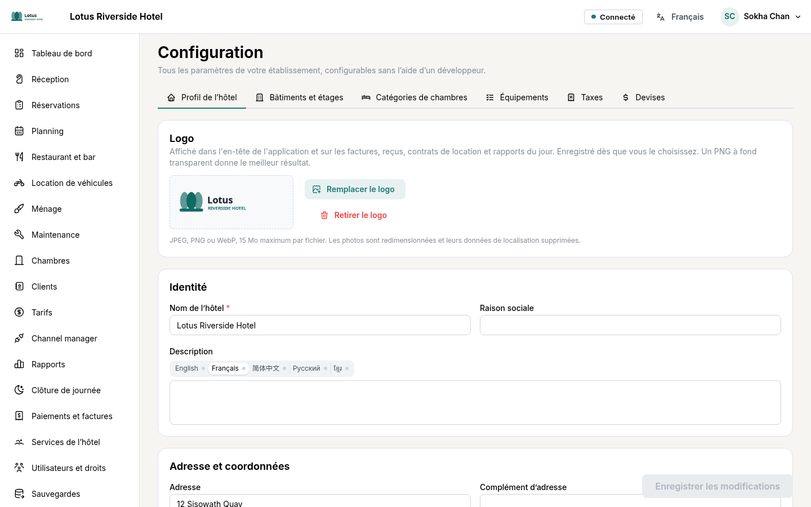
