# HMS — សៀវភៅណែនាំ

[Français](user-guide.fr.md) · [English](user-guide.en.md) · ខ្មែរ

## អំពីសៀវភៅណែនាំនេះ

សៀវភៅណែនាំនេះពន្យល់ម្តងមួយអេក្រង់ ពីរបៀបប្រើ HMS ជារៀងរាល់ថ្ងៃ៖ ការកក់ បញ្ជរទទួលភ្ញៀវ ការសម្អាតបន្ទប់ ការជួសជុល ភោជនីយដ្ឋាន ការជួលយានជំនិះ និងការបិទថ្ងៃ។ ផ្នែកចុងក្រោយសម្រាប់អ្នកគ្រប់គ្រងដែលរៀបចំការកំណត់របស់សណ្ឋាគារ។

- មានបីភាសា៖ Français, English និងខ្មែរ (ឯកសារនេះ)។ រូបថតអេក្រង់ជាភាសារបស់ឯកសារនីមួយៗ។
- រូបថតអេក្រង់បង្ហាញសណ្ឋាគារសាកល្បង *Lotus Riverside Hotel*។ ភ្ញៀវ និងការកក់ទាំងអស់មិនមែនជាទិន្នន័យពិតទេ។
- បុគ្គលិកម្នាក់ៗឃើញតែមឺនុយដែលត្រូវនឹងតួនាទីរបស់ខ្លួនប៉ុណ្ណោះ៖ បើខ្វះមឺនុយណាមួយ គឺជារឿងធម្មតា។
- ឈ្មោះប៊ូតុងត្រូវបានសរសេរជា **អក្សរដិត** ដូចដែលបង្ហាញលើអេក្រង់។

## ១. ការចាប់ផ្តើម

HMS បើកក្នុងកម្មវិធីរុករកតាមអាសយដ្ឋានម៉ាស៊ីនមេរបស់សណ្ឋាគារ (ឧទាហរណ៍ `https://hms.lan`) លើកុំព្យូទ័រ ថេប្លេត ឬក្នុងកម្មវិធីកុំព្យូទ័រ។ បុគ្គលិកម្នាក់ៗមានគណនីផ្ទាល់ខ្លួន។

1. បញ្ចូល **អ៊ីមែល** និង **ពាក្យសម្ងាត់** រួចចុច **ចូលគណនី**។ ប្រសិនបើបានបើកការផ្ទៀងផ្ទាត់ពីរជំហាន សូមបញ្ចូលលេខកូដ ៦ ខ្ទង់ពីកម្មវិធីរបស់អ្នក។ បាត់ទូរស័ព្ទ៖ ជ្រើសរើស **បាត់ទូរស័ព្ទ? ប្រើលេខកូដសង្គ្រោះ** ហើយវាយបញ្ចូលលេខកូដសង្គ្រោះមួយរបស់អ្នក (លេខកូដនីមួយៗប្រើបានតែម្តង)។
2. ប្តូរភាសាដោយប្រើប៊ូតុងភាសានៅជ្រុងខាងលើស្តាំ (English, Français, 简体中文, Русский, ខ្មែរ)។ ជម្រើសរបស់អ្នកនឹងនៅជាប់លើគ្រប់ឧបករណ៍។
3. មឺនុយនៅខាងឆ្វេងនាំទៅកាន់ផ្នែកនីមួយៗ។ លើថេប្លេត សូមបើកវាដោយប៊ូតុង ☰។
4. សញ្ញា **បានភ្ជាប់** នៅខាងលើបញ្ជាក់ថាការតភ្ជាប់ផ្ទាល់កំពុងដំណើរការ៖ អ្វីដែលមិត្តរួមការងាររក្សាទុក នឹងបង្ហាញលើអេក្រង់របស់អ្នកភ្លាមៗ ដោយមិនចាំបាច់ផ្ទុកទំព័រឡើងវិញ។
5. ដើម្បីចាកចេញ សូមបើកមឺនុយគណនី (អក្សរកាត់ឈ្មោះរបស់អ្នក) រួចចុច **ចេញពីគណនី**។

ប្រសិនបើបណ្តាញដាច់ នឹងមានសារជូនដំណឹងបង្ហាញ ហើយប៊ូតុងរក្សាទុកត្រូវបានបិទ៖ គ្មានអ្វីត្រូវបានរក្សាទុកពាក់កណ្តាលទេ។ សូមព្យាយាមម្តងទៀតនៅពេលសញ្ញាបង្ហាញ **បានភ្ជាប់** វិញ។

លើថេប្លេត អ្នកអាចបន្ថែម HMS ទៅអេក្រង់ដើម (iPad៖ Share → Add to Home Screen។ Android៖ មឺនុយ Chrome → Install app)។ កម្មវិធីកុំព្យូទ័រ (Windows, Linux) នឹងសួររកអាសយដ្ឋានម៉ាស៊ីនមេ នៅពេលបើកលើកដំបូង។

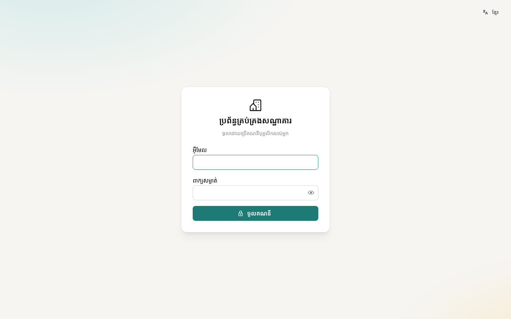

## ២. ផ្ទាំងគ្រប់គ្រង

**ផ្ទាំងគ្រប់គ្រង** សង្ខេបពីថ្ងៃនេះភ្លាមៗបន្ទាប់ពីចូលគណនី៖ អត្រាស្នាក់នៅយប់នេះ ភ្ញៀវមកដល់ ភ្ញៀវចាកចេញ និងភ្ញៀវកំពុងស្នាក់នៅ។

- តួលេខប្រចាំខែ៖ អត្រាស្នាក់នៅ តម្លៃមធ្យមក្នុងមួយបន្ទប់ (ADR) និង RevPAR។ ចំនួនទឹកប្រាក់បង្ហាញតែចំពោះគណនីដែលមានសិទ្ធិ «របាយការណ៍ហិរញ្ញវត្ថុ» ប៉ុណ្ណោះ។
- ១៤ យប់ខាងមុខដែលបានកក់ ស្ថានភាពបន្ទប់ (ស្អាត ត្រូវសម្អាត ផ្អាកដំណើរការ) និងចំនួនបន្ទប់របស់សណ្ឋាគារ។
- បញ្ជីភ្ញៀវមកដល់ និងចាកចេញ នាំទៅកាន់ការកក់នីមួយៗដោយផ្ទាល់។

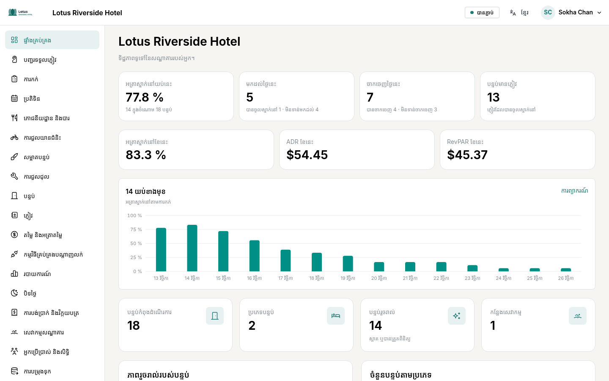

## ៣. ប្រតិទិន និងការកក់

**ប្រតិទិន** បង្ហាញមួយជួរសម្រាប់បន្ទប់នីមួយៗ និងមួយជួរឈរសម្រាប់ថ្ងៃនីមួយៗ៖ នេះជាកន្លែងបង្កើត និងផ្លាស់ទីការកក់។ ក្រោមប្រភេទបន្ទប់នីមួយៗ មានបង្ហាញចំនួនបន្ទប់ទំនេរសម្រាប់យប់នីមួយៗ។

**បង្កើតការកក់**

1. ចុចលើប្រអប់ទទេ (បន្ទប់ និងថ្ងៃមកដល់) ឬចុច **ការកក់ថ្មី**។
2. ជ្រើសរើសកាលបរិច្ឆេទ ប្រភេទបន្ទប់ ចំនួនមនុស្សពេញវ័យ និងកុមារ។ តម្លៃត្រូវបានគណនាតាមគម្រោងតម្លៃ។
3. ស្វែងរកភ្ញៀវ ឬបញ្ចូលភ្ញៀវថ្មី រួចរក្សាទុក។

**ផ្លាស់ទី**៖ អូសការកក់ទៅបន្ទប់ផ្សេង ឬកាលបរិច្ឆេទផ្សេង (លើថេប្លេត សូមចុចចំនួនយូរ) រួចបញ្ជាក់។ HMS មិនអនុញ្ញាតិឱ្យបន្ទប់មួយត្រូវបានកក់ពីរដងទេ ទោះបីប្រើឧបករណ៍ណាក៏ដោយ។ ការកក់ដែលមិនទាន់មានបន្ទប់ ស្ថិតនៅលើជួរ **ត្រូវចាត់បន្ទប់**។

**ទំព័រការកក់** មានព័ត៌មានការស្នាក់នៅ (បន្ទប់ កាលបរិច្ឆេទ តម្លៃ លក្ខខណ្ឌលុបចោល) តារាងគណនីភ្ញៀវ ការបង់ប្រាក់ វិក្កយបត្រ និងប្រវត្តិនៃការផ្លាស់ប្តូរទាំងអស់។

- **លុបចោលការកក់**៖ ថ្លៃពិន័យតាមគោលការណ៍លុបចោល ត្រូវបានបង្ហាញមុនពេលអ្នកបញ្ជាក់។
- **សម្គាល់ថាមិនមកដល់**៖ សម្រាប់ភ្ញៀវដែលរំពឹងថានឹងមក ប៉ុន្តែមិនបានមកដល់។

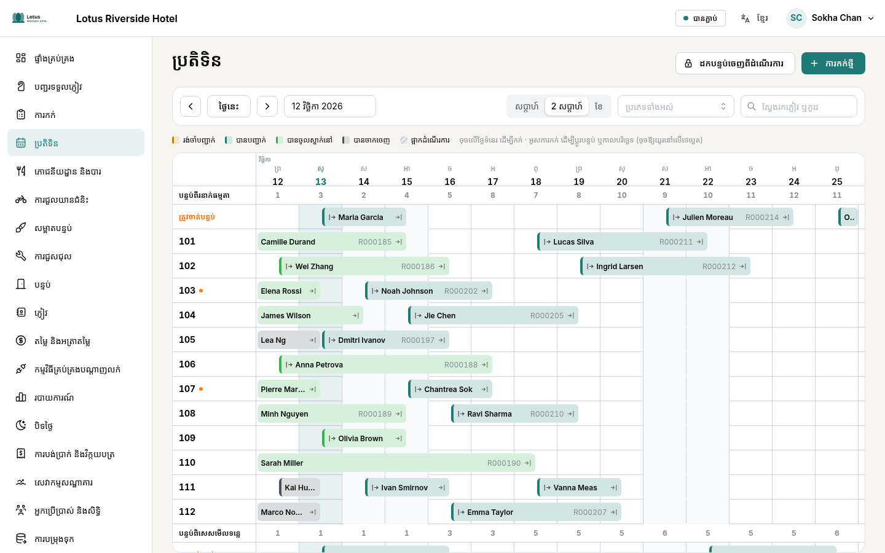

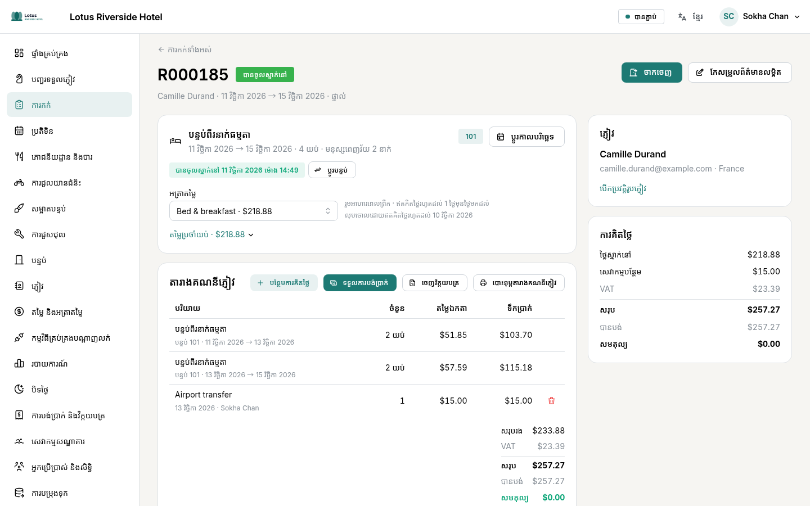

## ៤. បញ្ជរទទួលភ្ញៀវ៖ មកដល់ ស្នាក់នៅ ចាកចេញ

អេក្រង់ **បញ្ជរទទួលភ្ញៀវ** បង្ហាញភ្ញៀវមកដល់ ភ្ញៀវកំពុងស្នាក់នៅ ភ្ញៀវចាកចេញ និងស្ថានភាពបន្ទប់នីមួយៗសម្រាប់ថ្ងៃនោះ ព្រមទាំងសមតុល្យនៃការស្នាក់នៅនីមួយៗ។

**មកដល់**

1. ប្រសិនបើការកក់មិនទាន់មានបន្ទប់៖ ចុច **ចាត់បន្ទប់**។
2. ចុច **ចុះឈ្មោះចូលស្នាក់នៅ**។ ប្រសិនបើបន្ទប់មិនទាន់ស្អាត HMS នឹងជូនដំណឹង ហើយអ្នកអាចជ្រើសរើស **នៅតែចុះឈ្មោះចូលស្នាក់នៅ**។
3. ភ្ញៀវដែលមិនបានកក់៖ **ភ្ញៀវដើរចូល** បង្កើតការកក់សម្រាប់យប់នេះ។

**កំឡុងពេលស្នាក់នៅ** តារាងគណនីភ្ញៀវទទួលយកថ្លៃយប់ ថ្លៃសេវាបន្ថែមដែលបញ្ចូលដោយ **បញ្ចូលការគិតថ្លៃ** (មីនីបារ បោកគក់…) ព្រមទាំងវិក្កយបត្រភោជនីយដ្ឋាន និងការជួលយានជំនិះដែលគិតចូលបន្ទប់។

**ការបង់ប្រាក់**៖ ចុច **ទទួលការបង់ប្រាក់** ជ្រើសរើសវិធីបង់ (សាច់ប្រាក់ កាត ផ្ទេរ…) និងរូបិយប័ណ្ណ។ ប្រាក់រៀលត្រូវបានប្ដូរតាមអត្រាប្ដូរប្រាក់នៃថ្ងៃនោះ។ **បង្កាន់ដៃ (PDF)** បោះពុម្ពពីបញ្ជីការបង់ប្រាក់។

**ចាកចេញ**

1. ចុច **ចាកចេញ**។
2. ប្រសិនបើនៅមានសមតុល្យ សូមទទួលប្រាក់ ឬទុកវាឱ្យនៅបើក។ ការចាកចេញមុនពេលកំណត់ នឹងដោះលែងយប់ដែលនៅសល់។
3. **ចេញវិក្កយបត្រ** បង្កើតវិក្កយបត្រ PDF ដែលមានលេខរៀងជាប់គ្នា គ្មានលោត។ វិក្កយបត្រដែលបានចេញហើយ មិនអាចកែប្រែបានទេ៖ ត្រូវទុកវាជាមោឃៈ រួចចេញម្តងទៀត។

**ការចេញវិក្កយបត្រផ្ទាល់ទៅក្រុមហ៊ុន** (ភ្នាក់ងារទេសចរណ៍ ក្រុមហ៊ុន)៖ នៅលើការកក់ ចុច **កែសម្រួលព័ត៌មានលម្អិត** រួចជ្រើសរើសក្រុមហ៊ុននៅក្នុង **ការចេញវិក្កយបត្រផ្ទាល់**។ នៅពេលចាកចេញ ចុច **ផ្ទេរទៅ …** (នៅលើតារាងគណនីភ្ញៀវ ឬក្នុងផ្ទាំងចាកចេញ) ដើម្បីចេញវិក្កយបត្រក្នុងនាមក្រុមហ៊ុន និងទូទាត់តារាងគណនីភ្ញៀវ។ ក្រុមហ៊ុននឹងបង់ប្រាក់នៅពេលក្រោយ។ ថ្លៃសេវាបន្ថែមដែលភ្ញៀវបង់ដោយខ្លួនឯង ត្រូវទទួលប្រាក់មុនពេលផ្ទេរ។

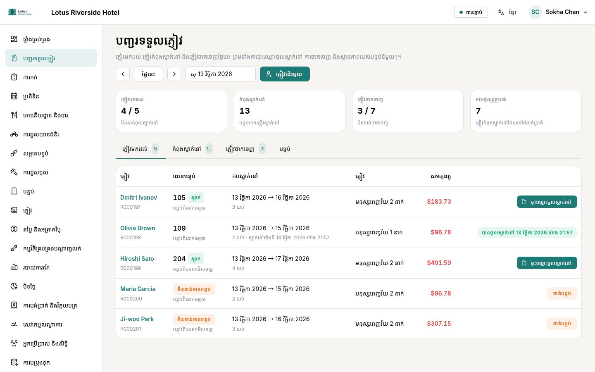

## ៥. ការសម្អាតបន្ទប់ និងការជួសជុល

**សម្អាតបន្ទប់**៖ រៀងរាល់ព្រឹក ចុច **រៀបចំបញ្ជីថ្ងៃនេះ** ដើម្បីបង្កើតកិច្ចការសម្អាតក្រោយភ្ញៀវចាកចេញ និងសេវាសម្អាតបន្ទប់ភ្ញៀវកំពុងស្នាក់នៅ ដោយផ្អែកលើការកក់។

1. អ្នកគ្រប់គ្រងចាត់ចែងកិច្ចការទៅបុគ្គលិកសម្អាត។
2. លើថេប្លេត បុគ្គលិកសម្អាតចុច **ចាប់ផ្ដើម** រួច **រួចរាល់**។
3. អ្នកគ្រប់គ្រងពិនិត្យបន្ទប់ ហើយចុច **អនុម័ត**៖ បន្ទប់ក្លាយជា **បានត្រួតពិនិត្យ** ហើយបញ្ជរទទួលភ្ញៀវឃើញភ្លាមៗ។

**ការជួសជុល**៖ បុគ្គលិកគ្រប់រូបអាចរាយការណ៍បញ្ហា ព្រមទាំងភ្ជាប់រូបថត។

1. **រាយការណ៍បញ្ហា**៖ ជ្រើសរើសបន្ទប់ (ឬ **កន្លែងផ្សេង** និងទីតាំង) ប្រភេទបញ្ហា អាទិភាព និងការពិពណ៌នាខ្លី។
2. **បន្ថែមរូបថត**៖ ថតរូបដោយថេប្លេត ឬជ្រើសរើសពីវិចិត្រសាល (ច្រើនបំផុត ១០ សន្លឹក)។ ទីតាំង GPS ត្រូវបានលុបចេញដោយស្វ័យប្រវត្តិ។
3. ចុច **ផ្ញើរបាយការណ៍**។ ជាងជួសជុលឃើញវាភ្លាមៗ។

ជាងជួសជុលចាប់ផ្ដើមការងារ ផ្អាកវា ឬបញ្ចប់វាដោយកត់ត្រាពីអ្វីដែលបានធ្វើ។ **ដកបន្ទប់ចេញពីដំណើរការ** បិទបន្ទប់សម្រាប់កាលបរិច្ឆេទដែលបានជ្រើសរើស៖ គ្មានការកក់ណាអាចចូលមកបន្ទប់នោះបានទេ។ នៅពេលការងារចប់ បន្ទប់ត្រឡប់មកដំណើរការវិញ ហើយត្រូវបានបញ្ជូនទៅសម្អាត។

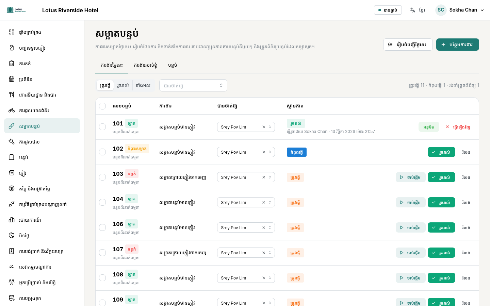

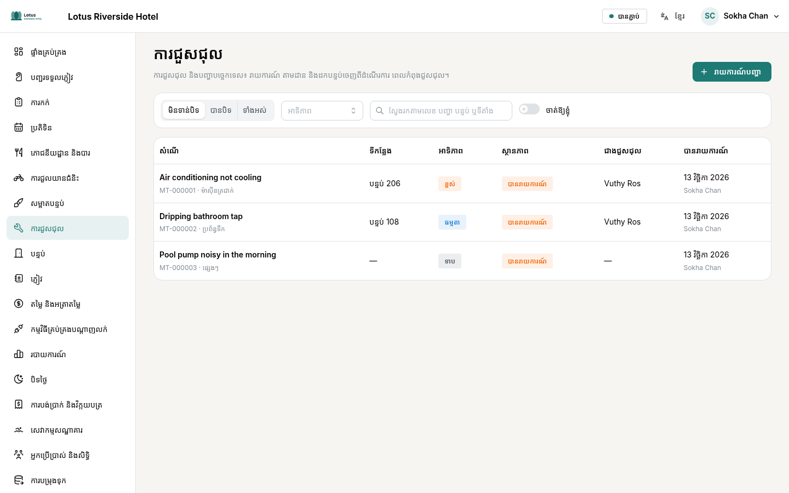

## ៦. ភោជនីយដ្ឋាន និងបារ

ផ្ទាំង **តុ** បង្ហាញប្លង់តុជាមួយវិក្កយបត្រដែលនៅបើក។ ការកុម្ម៉ង់ខ្ចប់យកទៅ និងសេវាកម្មក្នុងបន្ទប់មានបញ្ជីដាច់ដោយឡែក។

1. ចុចលើតុ ហើយបន្ថែមមុខម្ហូបពីមឺនុយ (បរិមាណ និងកំណត់សម្គាល់សម្រាប់ផ្ទះបាយ)។
2. ចុច **បញ្ជូនទៅផ្ទះបាយ**៖ អេក្រង់ **ផ្ទះបាយ** (និងអេក្រង់បារ) បង្ហាញមុខម្ហូបនីមួយៗ ជាមួយរយៈពេលតាំងពីពេលបញ្ជូន។ ផ្ទះបាយសម្គាល់នៅពេលរួចរាល់។
3. នៅចុងអាហារ សូមទទួលប្រាក់ (សាច់ប្រាក់ជាមួយប្រាក់អាប់ កាត…) ឬជ្រើសរើស **គិតចូលបន្ទប់** សម្រាប់ភ្ញៀវសណ្ឋាគារ៖ ចំនួនទឹកប្រាក់នឹងបង្ហាញក្នុងតារាងគណនីភ្ញៀវរបស់គាត់។
4. វិក្កយបត្រអាចបោះពុម្ពជា PDF។

មុខម្ហូបដែលបានបញ្ជូនទៅផ្ទះបាយរួច មិនអាចលុបបានទេ៖ ត្រូវទុកវាជាមោឃៈ ព្រមទាំងបញ្ជាក់មូលហេតុ។

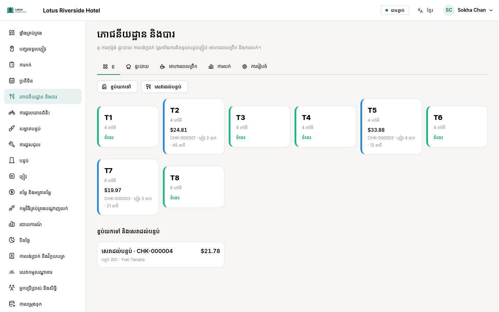

## ៧. ការជួលយានជំនិះ

ម៉ូតូស្កុយទ័រ រថយន្តមាន ឬគ្មានអ្នកបើកបរ តុកតុក និងកង់ អាចជួលតាមម៉ោង ឬតាមថ្ងៃ។ កាលវិភាគបង្ហាញយានជំនិះនីមួយៗ និងការជួលរបស់វា។

1. **ការជួលថ្មី**៖ ជ្រើសរើសអតិថិជន (ភ្ញៀវសណ្ឋាគារ ឬអតិថិជនផ្សេង) យានជំនិះដែលទំនេរ និងរយៈពេល។ តម្លៃ និងប្រាក់កក់ធានា ត្រូវបានបង្ហាញមុនពេលកក់។
2. **ប្រគល់យានជំនិះ**៖ លេខប័ណ្ណបើកបរ (មើលឃើញតែ ៤ ខ្ទង់ចុងក្រោយប៉ុណ្ណោះ) លេខគីឡូម៉ែត្រ ប្រេងឥន្ធនៈ និងប្រាក់កក់ធានាដែលបានទទួល។
3. **ទទួលយកវិញ**៖ លេខគីឡូម៉ែត្រ និងប្រេងឥន្ធនៈនៅពេលយកមកវិញ និងថ្លៃបន្ថែម (បើមាន)។
4. ទទួលប្រាក់ ឬគិតចូលបន្ទប់ភ្ញៀវ។ **កិច្ចសន្យា** បោះពុម្ពជា PDF សម្រាប់អតិថិជន និងសណ្ឋាគារចុះហត្ថលេខា។

យានជំនិះដែលនៅខាងក្រៅ មិនអាចប្រគល់ទៅអតិថិជនផ្សេងបានទេ។ ការប្រគល់យឺតយ៉ាវត្រូវបានសម្គាល់ថា **ហួសពេលប្រគល់**។

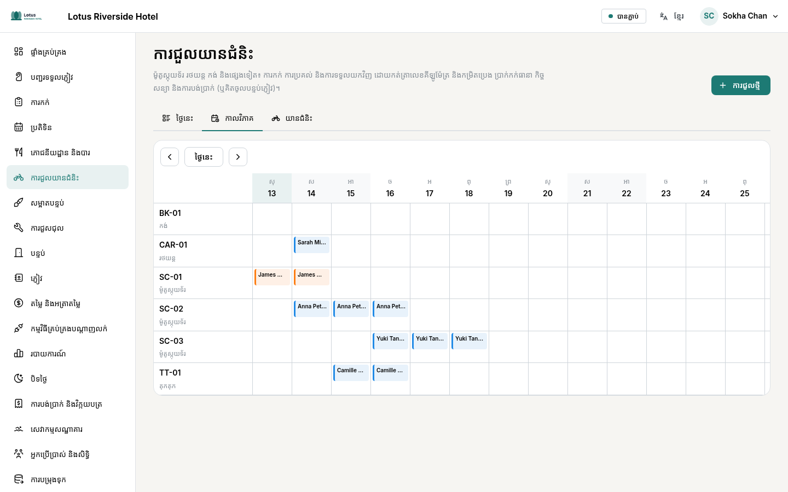

## ៨. តម្លៃ និងកម្មវិធីគ្រប់គ្រងបណ្ដាញលក់

**ប្រតិទិនតម្លៃ** បង្ហាញតម្លៃនៃប្រភេទបន្ទប់នីមួយៗ ម្តងមួយយប់ សម្រាប់គម្រោងតម្លៃនីមួយៗ។ ចុចលើថ្ងៃណាមួយ ដើម្បីប្តូរតម្លៃ ឬបិទការលក់ (រយៈពេលស្នាក់នៅអប្បបរមា មិនទទួលភ្ញៀវមកដល់…)។

- គម្រោងតម្លៃអាចបង្កើតចេញពីគម្រោងមូលដ្ឋាន (ឧទាហរណ៍ −១០% មិនអាចលុបចោលបាន រួមមានអាហារពេលព្រឹក)។
- រដូវកាល និងវិធាន (បញ្ចុះតម្លៃ ថ្លៃបន្ថែម) ត្រូវបានអនុវត្តដោយស្វ័យប្រវត្តិ។ ម៉ាស៊ីនគណនាតែមួយគណនាតម្លៃទាំងអស់ ទាំងក្នុងប្រតិទិន និងក្នុងការកក់។

**កម្មវិធីគ្រប់គ្រងបណ្ដាញលក់** ភ្ជាប់ HMS ទៅនឹង SiteMinder ដែលចែកចាយទៅ Booking.com, Agoda និងគេហទំព័រផ្សេងទៀត។ នៅទីនោះ ប្រភេទបន្ទប់ និងគម្រោងតម្លៃនីមួយៗ ត្រូវបានផ្គូផ្គងនឹងលេខកូដរបស់វានៅ SiteMinder។ អ្នកអាចពិនិត្យការកក់ដែលបានទទួល និងកំណត់ត្រានៃការផ្លាស់ប្តូរទិន្នន័យទាំងអស់។ ការចាប់ផ្ដើមដំណើរការពិត ធ្វើឡើងជាមួយអ្នកគ្រប់គ្រងផ្នែកបច្ចេកទេស។

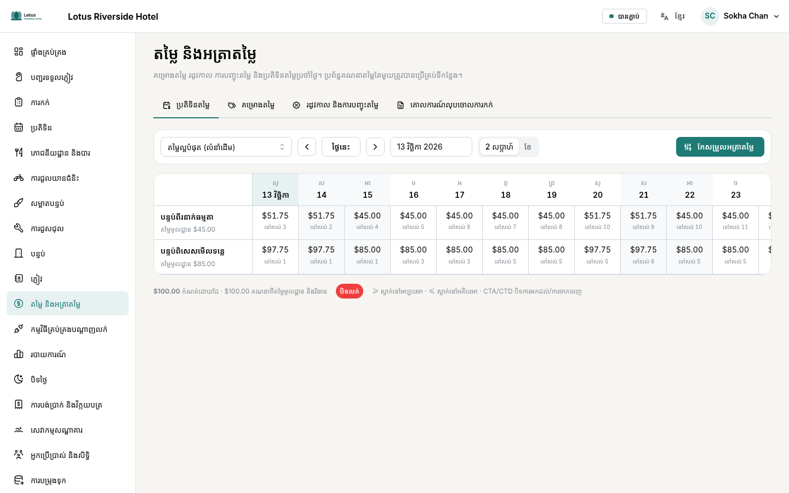

## ៩. របាយការណ៍ និងការបិទថ្ងៃ

**របាយការណ៍** ផ្ដល់អត្រាស្នាក់នៅ ADR RevPAR និងចំណូលតាមរយៈពេល ប្រៀបធៀបនឹងរយៈពេលមុន ព្រមទាំងការព្យាករណ៍។ តារាងនីមួយៗអាចនាំចេញជា CSV។

**បិទថ្ងៃ** ត្រូវធ្វើបន្ទាប់ពីពាក់កណ្ដាលអធ្រាត្រ សម្រាប់ថ្ងៃដែលទើបតែបញ្ចប់ (ជាធម្មតាដោយអ្នកទទួលភ្ញៀវវេនយប់)។

1. ដោះស្រាយអ្វីដែលនៅបើក៖ ភ្ញៀវដែលរំពឹងថាមក ប៉ុន្តែមិនបានមកដល់ (ប៊ូតុង **សម្គាល់ថាមិនមកដល់**) ភ្ញៀវដែលត្រូវចាកចេញតែនៅស្នាក់នៅ វិក្កយបត្រភោជនីយដ្ឋានដែលនៅបើក យានជំនិះដែលមិនទាន់ប្រគល់វិញ ភ្ញៀវមកដល់ថ្ងៃស្អែកដែលមិនទាន់មានបន្ទប់ និងសមតុល្យដែលត្រូវបង់។
2. ពិនិត្យតួលេខប្រចាំថ្ងៃ និងសាច់ប្រាក់តាមវិធីបង់នីមួយៗ (បញ្ជរទទួលភ្ញៀវ ភោជនីយដ្ឋាន ការជួល)។
3. ចុច **បិទថ្ងៃ**។ **របាយការណ៍ប្រចាំថ្ងៃ (PDF)** ត្រូវបានរក្សាទុក។

ថ្ងៃដែលបានបិទហើយត្រូវបានចាក់សោ៖ មិនអាចបន្ថែម ឬទុកជាមោឃៈនូវការគិតថ្លៃ ឬការបង់ប្រាក់ណាមួយបានទៀតទេ។ ការកែតម្រូវត្រូវធ្វើនៅថ្ងៃបច្ចុប្បន្ន។

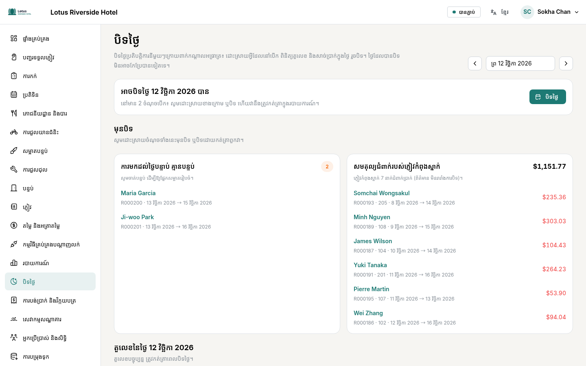

**គណនីក្រុមហ៊ុន** (ផ្នែកគណនេយ្យ)៖ សមតុល្យរបស់ក្រុមហ៊ុននីមួយៗ វិក្កយបត្រដែលមិនទាន់បង់ និងរយៈពេលយឺតយ៉ាវ (មិនទាន់ដល់ថ្ងៃកំណត់ យឺត ១–៣០ ថ្ងៃ…)។ នៅពេលក្រុមហ៊ុនបង់ប្រាក់ ចុច **កត់ត្រាការបង់ប្រាក់**៖ ចំនួនទឹកប្រាក់ត្រូវកាត់ពីវិក្កយបត្រចាស់ជាងគេមុន។ **របាយការណ៍ (PDF)** ត្រូវផ្ញើទៅក្រុមហ៊ុន។ ការផ្ទេរមិនមែនជាប្រាក់ដែលបានទទួលទេ៖ វាមិនរាប់បញ្ចូលក្នុងសាច់ប្រាក់ប្រចាំថ្ងៃទេ ប៉ុន្តែការបង់ប្រាក់ពីក្រុមហ៊ុនត្រូវរាប់បញ្ចូល។

## ១០. ការកំណត់ (សម្រាប់អ្នកគ្រប់គ្រង)

**ការកំណត់** ពិពណ៌នាអំពីសណ្ឋាគារ។ វាសម្រាប់អ្នកគ្រប់គ្រងប្រព័ន្ធ និងអ្នកគ្រប់គ្រងសណ្ឋាគារ។

- **ព័ត៌មានសណ្ឋាគារ**៖ ឈ្មោះ អាសយដ្ឋាន ទំនាក់ទំនង តំបន់ម៉ោង រូបិយប័ណ្ណ ភាសា ម៉ោងចូលស្នាក់នៅ និងចាកចេញ គោលការណ៍ និងព័ត៌មានលើវិក្កយបត្រ។ **ឡូហ្គោ** (ប៊ូតុង **បញ្ចូលឡូហ្គោ**) បង្ហាញនៅផ្នែកខាងលើ និងលើឯកសារ PDF ទាំងអស់។ វាត្រូវបានរក្សាទុកភ្លាមៗនៅពេលអ្នកជ្រើសរើស។
- **ប្រភេទបន្ទប់**៖ ចំនួនមនុស្ស គ្រែ តម្លៃមូលដ្ឋាន គ្រឿងប្រើប្រាស់ និងរូបថតរហូតដល់ ២០ សន្លឹក (**បន្ថែមរូបថត** អាចប្តូរលំដាប់បាន)។ បន្ទប់អាចបង្កើតម្តងមួយ ឬជាស៊េរី (១០១ ដល់ ១២០)។
- **សេវាកម្មសណ្ឋាគារ**៖ កន្លែងសេវាកម្ម (អាងហែលទឹក ស្ពា…) ជាមួយម៉ោងបើក និងរូបថត និងសេវាបន្ថែមដែលលក់។
- **អ្នកប្រើប្រាស់ និងសិទ្ធិ**៖ **បន្ថែមអ្នកប្រើប្រាស់** ហើយផ្ដល់តួនាទី (ទទួលភ្ញៀវ សម្អាតបន្ទប់ ជួសជុល ភោជនីយដ្ឋាន គណនេយ្យ…)។ ឧបករណ៍ដែលកំពុងតភ្ជាប់ ប្រវត្តិចូលគណនី និងកំណត់ត្រានៃការផ្លាស់ប្តូរ ក៏មាននៅទីនេះដែរ។ តួនាទីមួយអាចតម្រូវឱ្យប្រើការផ្ទៀងផ្ទាត់ពីរកត្តា (កុងតាក់នៅលើកាតរបស់វា)៖ អ្នកដែលមានតួនាទីនោះត្រូវរៀបចំវានៅពេលចូលគណនីលើកក្រោយ។
- **ការបម្រុងទុក**៖ ស្ថានភាពនៃការបម្រុងទុកស្វ័យប្រវត្តិ **បម្រុងទុកឥឡូវនេះ** និងការស្ដារទិន្នន័យ (ត្រូវការពាក្យសម្ងាត់ និងលេខកូដសណ្ឋាគារ)។ រូបថត និងឡូហ្គោ មានរួមបញ្ចូលក្នុងការបម្រុងទុក។

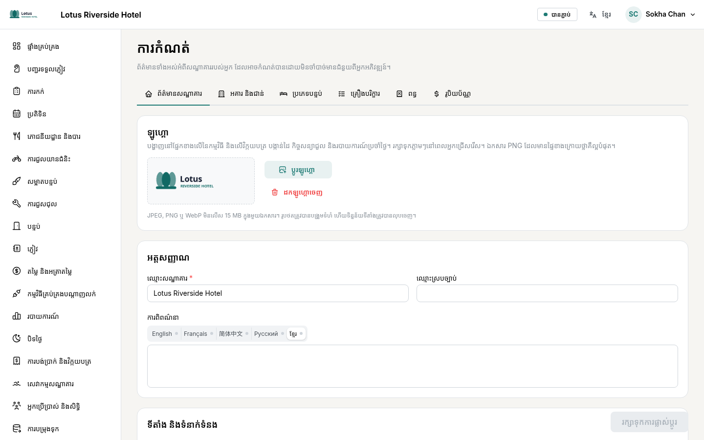
